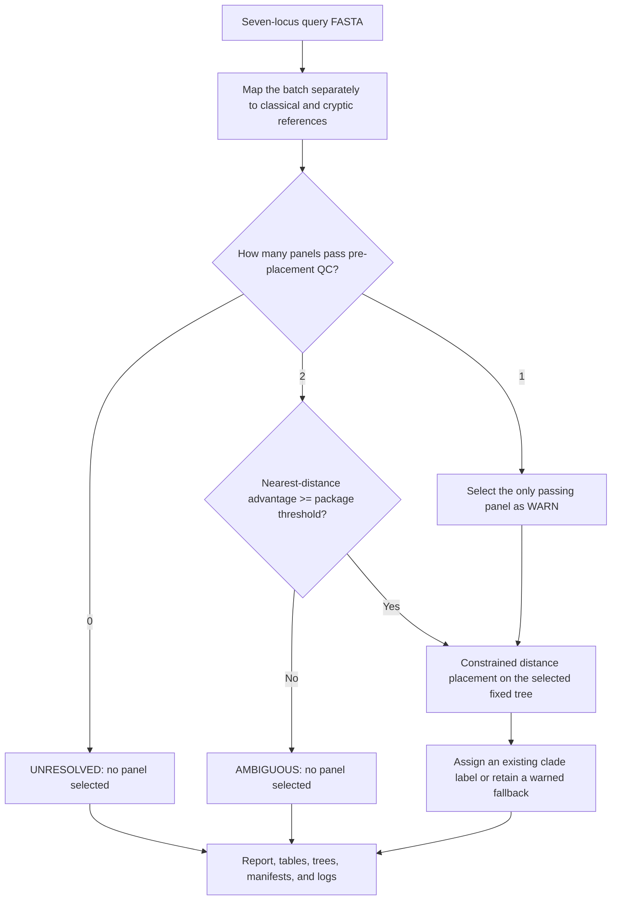

# TreeTip Placer

_Conservative fixed-tree placement and clade screening for concatenated
seven-locus *Clostridioides difficile* MLST sequences_

TreeTip Placer takes one or more isolate sequences, compares each one with
fixed classical and cryptic reference panels, and reports three separate
results: which panel is supported, how well the sequence can be placed, and
which reference clade is the closest defensible assignment.

The routine result is a self-contained `report.html` for people, plus TSV,
JSON, tree, manifest, and log files for review or downstream analysis. The tool
is deliberately conservative: it records an ambiguous or unresolved result
when the available sequence does not support a clear call.

> **Current availability:** this repository is private and requires authorized
> GitHub access. The software and documentation are Apache-2.0 licensed, but
> the bundled reference package is separately restricted and is not cleared
> for public redistribution. TreeTip Placer is a research and screening tool,
> not a clinical diagnostic.

---

## 📋 Contents

- [What TreeTip Placer answers](#-what-tree-tip-placer-answers)
- [Quick start](#-quick-start)
- [How classification works](#-how-classification-works)
- [How to interpret a result](#-how-to-interpret-a-result)
- [Complete output map](#-complete-output-map)
- [Methods and technical defaults](#-methods-and-technical-defaults)
- [Reference package, validation, and limits](#-reference-package-validation-and-limits)
- [Advanced workflows and documentation](#-advanced-workflows-and-documentation)

## 🎯 What TreeTip Placer answers

*Clostridioides difficile*, often shortened to *C. difficile* or *C. diff*, is
a bacterial species associated with diarrhoea and inflammation of the
colon.[^1] TreeTip Placer does not diagnose infection. It works only with
prepared nucleotide sequence data from an isolate.

For each input isolate, it asks:

1. Is the sequence distinctly closer to the bundled **classical** panel or the
   bundled **cryptic** panel?
2. Where does it fit on the selected panel's existing branch-length tree?
3. Which reference clade label is supported, and did any quality or ambiguity
   rule require a warning or no-call?

Here, **classical** means the package's five `Clade-1` to `Clade-5` reference
groups. **Cryptic** means its seven `C-I` to `C-VII` groups. These are
operational labels from this versioned reference package, not diagnoses or
probabilities.

### Concepts in plain language

| Term | Meaning in this project |
| --- | --- |
| **Isolate** | One bacterial sample or culture represented by one input sequence. |
| **FASTA** | A text format in which a line beginning with `>` names a record and the following line or lines contain its sequence. |
| **Locus** | A defined region of DNA. This workflow uses seven housekeeping-gene loci. |
| **MLST** | Multilocus sequence typing: a typing scheme based on defined allele sequences from several loci. PubMLST assigns identifiers to alleles and to each unique allele combination, called a sequence type or ST.[^2] |
| **Concatenation** | The seven locus sequences joined end to end in one required order, without headings or separators inside the sequence. |
| **Reference panel** | A curated alignment and tree whose tips already represent known sequences and clade labels. |
| **Clade** | A named reference grouping used by the package. A TreeTip clade result inherits an existing label; it does not create a new clade. |
| **Fixed tree** | A reference tree whose topology and branch lengths remain unchanged while queries are added. |
| **Placement** | Estimating the existing tree edge and terminal branch that best reproduce a query's distances to reference tips. |

### What it does and does not do

| TreeTip Placer does | TreeTip Placer does not |
| --- | --- |
| Map prepared query sequences to both bundled reference alignments | Extract MLST loci from an assembly or raw reads |
| Apply pre-placement coverage and comparability QC | Accept a whole-genome assembly as routine `classify` input |
| Compare classical and cryptic nearest-reference distances | Accept an allele-number profile or an ST number in place of nucleotide sequence |
| Place eligible queries on an immutable reference tree | Infer a new phylogeny or modify the reference topology |
| Assign an existing clade label conservatively | Discover or name a new clade |
| Retain alternatives, findings, hashes, parameters, and logs | Provide whole-genome, transmission, recombination, or clinical interpretation |

The underlying engine can also work with another curated fixed-column
nucleotide reference, but `classify --organism cdifficile-mlst` is the only
bundled routine configuration in version 0.7.0.

## ⚡ Quick start

### 1. Prepare the input FASTA

Routine `classify` input is an **unaligned nucleotide FASTA** with one record
per isolate. Each record must be the concatenation of these seven loci in this
exact order:

```text
adk -> atpA -> dxr -> glyA -> recA -> sodA -> tpi
```

This small synthetic file illustrates the FASTA structure only. Its sequences
are deliberately too short to classify and contain no biological data:

```fasta
>example_A
ATGCGTACGTTAGCTAGCTACGATCGATCGTACGATGCTAGCTAGCATCGATCGATCGTACG
>example_B
ATGCGTACGTTAGCTAGCTACGATCGATCGTACGATGCTAGCTAGCATCGATCGATCGTACC
```

In a real file, each nucleotide string is the complete, unseparated
`adk`-through-`tpi` concatenation. Long sequences may be wrapped over several
lines. The first word after `>` becomes the isolate ID, so IDs must be unique.

Before running, confirm all of the following:

- the records contain nucleotide sequences, not proteins;
- every record represents the same seven loci in the required order;
- the file is not a genome assembly, read set, allele-number table, or ST list;
- IDs are short, unique, and do not duplicate bundled reference-tip IDs; and
- the extraction and concatenation method is documented outside TreeTip
  Placer.

Raw query records may differ in length or be incomplete. MAFFT maps them to the
fixed 3501-column reference coordinates, after which TreeTip applies coverage
and comparability QC. TreeTip validates FASTA structure and mapped-sequence QC,
but it cannot determine whether an upstream program extracted the correct loci
or joined them in the correct order. If you currently have only assemblies,
reads, allele numbers, or ST labels, obtain the seven locus nucleotide
sequences with a validated upstream MLST workflow before using this tool.

### 2. Install the software

A **terminal** is the text window in which you type commands. On macOS, use
Terminal; on Linux, use your distribution's terminal application. Run the
following commands one at a time:

```bash
git clone https://github.com/crodsa/treetip-placer.git
cd treetip-placer
python3 -m venv .venv
source .venv/bin/activate
python -m pip install -e .
treetip setup
treetip --version
```

The editable install (`-e`) is intentional. TreeTip Placer 0.7.0 resolves its
environment specification and bundled reference package from this cloned
repository, so keep the checkout in place after installation. The project can
build a wheel for packaging checks, but that wheel is not a supported
standalone distribution of those repository resources.

Requirements:

- authorized access to this private repository;
- Python 3.11 or newer;
- `git` and network access for the initial installation; and
- one Conda-compatible manager available as `micromamba`, `mamba`, or `conda`.

`treetip setup` chooses the first available manager in that order, creates a
dedicated user-scoped environment, installs and verifies MAFFT 7.526 from
`conda-forge`, and records the exact executable. It does not modify the active
Conda environment or the user's `PATH`. Managed setup supports macOS and Linux.
On Windows, use a Linux environment such as WSL or supply a separately verified
MAFFT executable with `classify --mafft` or `place-auto --mafft`.

Use `treetip setup --refresh` only when you intend to recreate TreeTip's managed
MAFFT environment. A successful version check currently prints `0.7.0`.

### 3. Classify the isolates

With the virtual environment active and `my_isolates.fasta` in the current
folder, run:

```bash
treetip classify my_isolates.fasta --organism cdifficile-mlst
```

That one command automatically:

- selects the bundled `mlst-cdifficile-20260806` package;
- resolves a verified MAFFT executable;
- uses the package's calibrated panel-separation threshold; and
- creates a UTC timestamped directory such as
  `my_isolates_classify_20260815T143000Z`.

The three `Using ...` and `Writing output to ...` lines printed before the run
are information, not additional commands. To choose the result-directory name,
add `--output my_results`. The destination must be new or empty; the program
refuses to overwrite a non-empty output directory.

### 4. Open the result

Open the reported output directory and double-click `report.html`. It is a
self-contained summary that can be opened in an ordinary web browser without a
server. Start there, then use the TSV or JSON files when exact values or an
auditable machine-readable result are required.

## 🔄 How classification works



The implementation follows these steps:

1. **Map to both panels.** MAFFT runs once against the classical alignment and
   once against the cryptic alignment using `--add --keeplength`. The reference
   columns are preserved. Both mapped query alignments are retained.
2. **Run per-panel QC and placement.** Coverage, callable overlap, ambiguous
   bases, and nearest-reference distance are evaluated for each panel. Unless
   `--force` is deliberately used, a panel that fails pre-placement QC is not
   placed.
3. **Select a panel conservatively.** If both panels pass QC, the selector
   subtracts the smaller nearest-reference normalized Hamming distance from the
   larger one. The bundled package requires a margin of at least `0.01`. A
   smaller margin becomes `AMBIGUOUS`; no panel is selected. If only one panel
   passes QC, that panel may be retained as `WARN`.
4. **Place on the fixed tree.** Eligible queries are placed independently. The
   algorithm searches candidate edges, fits a non-negative attachment point
   and terminal branch by constrained least squares, and records ranked edge
   alternatives. It never rebuilds the backbone.
5. **Assign a clade.** A single clade among labelled reference tips below the
   selected edge can support a direct call. Mixed, unlabelled, or conflicting
   edge evidence may use the nearest labelled reference only as an explicit
   `WARN`. An unresolved placement cannot be promoted to a clade call.
6. **Write the audit trail.** Both panel-specific runs are preserved even when
   only one panel is selected. Decisions, QC, mappings, tree files, parameters,
   hashes, event logs, and the human-readable report stay together.

## 📊 How to interpret a result

### Start with `report.html`

The report shows assignment counts and one row per query with the panel call,
clade call, decision statuses, both nearest-reference distances, distance
margin, and finding codes. For every query with a selected panel it also shows
exactly two display-only views of the selected immutable tree:

- **Global clade context:** keeps the query visible, collapses reference-only
  subtrees into clade, mixed, or unlabelled groups, and does not expose
  reference-tip identifiers.
- **Local placement branch:** highlights the attachment branch and shows up to
  12 named neighbouring reference tips; omitted reference-only subtrees are
  collapsed.

These diagrams help inspection but do not alter the tree, calculate support, or
replace the tabular results. `report.html` is a non-authoritative index. The
root TSV/JSON decision files and the per-panel TSV/JSON QC and placement files
carry the exact result.

### Keep the three decision layers separate

| Layer | Question | Possible values | Authoritative file |
| --- | --- | --- | --- |
| **Panel assignment** | Which reference panel is sufficiently closer? | `CLASSICAL`, `CRYPTIC`, `AMBIGUOUS`, `UNRESOLVED` | `panel_assignment.tsv` or `.json` |
| **Selected placement status** | Did sequence QC and the fixed-tree fit support a usable placement? | `PASS`, `WARN`, `UNRESOLVED`, `FAIL` within each panel | `panels/<panel>/placements/placements.tsv` or `.json` |
| **Clade assignment** | Which existing label is supported inside the selected panel? | A clade plus `PASS` or `WARN`, or no label plus `UNRESOLVED` | `clade_assignment.tsv` or `.json` |

The labels mean:

- `CLASSICAL` or `CRYPTIC`: one panel was selected. Read the decision,
  placement, and clade statuses before treating the label as clean.
- `AMBIGUOUS`: both panels passed QC, but their nearest-distance advantage was
  below `0.01`. The program deliberately selected neither panel.
- `UNRESOLVED`: the available sequence or placement evidence could not support
  that layer of the result. At panel level, this normally means no panel passed
  QC.
- `PASS`: no rule changed that layer to a warning or no-call. Still inspect the
  findings field, especially when bootstrap was requested.
- `WARN`: a call was retained, but one or more named findings require review.
  It is not a probability and not automatically a failure.
- `FAIL`: a blocking per-panel pre-placement QC or scoring failure occurred.
  If the other panel remains eligible it may still be selected as `WARN`; if
  neither is eligible, the final panel assignment is `UNRESOLVED`.

Always read the `findings` field. It contains stable codes such as
`PANEL_DISTANCE_MARGIN_TOO_SMALL`, `LOW_COVERAGE`,
`INSUFFICIENT_COMPARABLE_SITES`, `DIFFUSE_DISTANCE_WEIGHT`,
`LONG_TERMINAL_BRANCH`, `UNSTABLE_BOOTSTRAP_PLACEMENT`, or
`MIXED_CLADE_LABELS_ON_SELECTED_EDGE`. The per-panel `query_qc.tsv` also stores
the severity and full human-readable message.

### Do not confuse the numerical fields

| Field | What it measures | How to read it |
| --- | --- | --- |
| `coverage` | Fraction of the 3501 mapped reference columns that are callable in the query | Below 0.70 fails QC; 0.70 to below 0.90 warns by default |
| `comparable_sites` | Callable sites shared with the nearest reference | Below 100 fails QC by default |
| `nearest_distance` | Mismatching bases divided by pairwise callable sites for the nearest reference | Lower means closer in this marker alignment; it is not whole-genome distance |
| `distance_margin` | Larger panel distance minus smaller panel distance | At least 0.01 is required when both panels pass QC |
| `distance_objective` | Squared residual error for a candidate tree-edge fit | Used to rank candidate edges inside one tree; do not compare it across panels |
| `rmse` | Root mean squared residual for the fitted edge | Describes distance-fit error inside that panel |
| `relative_fit_weight` | Heuristic concentration of the candidate-edge fits | Not a likelihood weight ratio, posterior probability, or calibrated confidence |
| `bootstrap_edge_support` | Fraction of successful site-resampled replicates returning the same edge, when requested | A placement-stability diagnostic; not support for the reference-tree branch |

### Worked synthetic interpretations

The following numbers are illustrative logic examples, not observed isolates or
performance estimates.

| Example | Result summary | Interpretation |
| --- | --- | --- |
| `example_A` | `CLASSICAL`; decision `PASS`; placement `PASS`; `Clade-2` with clade `PASS`; distances 0.012 and 0.074; margin 0.062 | The classical distance is lower and the margin exceeds 0.01. The placement and clade rule raised no finding. This supports a clean package-relative call, not strain-level identity. |
| `example_B` | `CRYPTIC`; decision `WARN`; placement `WARN`; `C-III` with clade `WARN`; finding `MIXED_CLADE_LABELS_ON_SELECTED_EDGE` | A cryptic panel was selected, but nearby edge labels were mixed, so the clade came from a named nearest-reference fallback. Retain the call with its warning and inspect the local tree, distances, and QC. |
| `example_C` | `AMBIGUOUS`; decision `UNRESOLVED`; distances 0.030 and 0.036; margin 0.006; no clade | Both panels were usable but too similarly distant for the 0.01 rule. Do not choose the smaller number manually and report it as a TreeTip call. Review sequence preparation and use broader genomic evidence if the distinction matters. |

## 🗂️ Complete output map

A routine automatic run has this structure. `<panel>` below means both
`classical` and `cryptic`; each receives a complete independent run.

```text
my_results/
├── report.html
├── panel_assignment.tsv
├── panel_assignment.json
├── clade_assignment.tsv
├── clade_assignment.json
├── run.log
├── events.jsonl
├── mapping/
│   ├── classical.mapped_with_reference.fasta
│   ├── classical.queries_mapped.fasta
│   ├── classical.mafft.stderr.log
│   ├── cryptic.mapped_with_reference.fasta
│   ├── cryptic.queries_mapped.fasta
│   └── cryptic.mafft.stderr.log
├── selected_trees/
│   ├── classical.selected_placed_tree.nwk
│   └── cryptic.selected_placed_tree.nwk
└── panels/
    ├── classical/
    └── cryptic/
```

Each `panels/<panel>/` directory contains:

```text
panels/<panel>/
├── run_manifest.json
├── events.jsonl
├── trees/
│   ├── placed_tree.nwk
│   ├── reference_tree.normalized.nwk
│   └── placed_tree.nexus
├── placements/
│   ├── placements.tsv
│   ├── alternative_edges.tsv
│   ├── placements.json
│   └── placements.jplace
└── qc/
    └── query_qc.tsv
```

| Path or group | Purpose and authority |
| --- | --- |
| `report.html` | Human-readable, self-contained index. Best first view; not the authoritative data source. |
| `panel_assignment.tsv` | One authoritative cross-panel decision row per query, suitable for a spreadsheet. |
| `panel_assignment.json` | The same decisions plus selection and mapper provenance for software use. |
| `clade_assignment.tsv` | Authoritative clade label, status, method, nearest reference, supporting tips, and findings. |
| `clade_assignment.json` | The same clade decisions plus provenance for software use. |
| `mapping/` | Both MAFFT mapped-with-reference alignments, extracted query-only fixed-column alignments, and mapper stderr logs. These preserve the coordinate-mapping evidence. |
| `selected_trees/` | Directly drawable Newick trees containing only queries selected for that panel. A file still exists when no query selected that panel; inspect the root decisions before using it. |
| `panels/<panel>/placements/placements.tsv` | Authoritative per-query QC, best edge, branch lengths, objective, RMSE, relative-fit weight, optional bootstrap support, search scope, and findings for that panel. |
| `panels/<panel>/placements/alternative_edges.tsv` | Ranked alternative edge fits for uncertainty review. |
| `panels/<panel>/placements/placements.json` | Machine-readable complete placement results and QC for that panel. |
| `panels/<panel>/placements/placements.jplace` | Experimental distance-based JPlace-shaped document. It is not a maximum-likelihood JPlace result. |
| `panels/<panel>/qc/query_qc.tsv` | One row per QC finding, including stable code, severity, and message; a query with no finding receives an empty finding row. |
| `panels/<panel>/trees/` | Drawing-oriented placed Newick, normalized reference Newick, and Nexus files. They do not carry the authoritative decision logic. |
| `panels/<panel>/run_manifest.json` | Tree, reference, and mapped-query paths; SHA-256 hashes; TreeTip version; parameters; panel; input kind; and resolved worker count. |
| `panels/<panel>/events.jsonl` | Structured progress and run events accumulated during that panel run. |
| `run.log` | Human-readable full automatic-workflow event log, including mapping, both placements, panel selection, clade assignment, and completion. |
| `events.jsonl` | Root-level structured terminal completion event, appended only after the primary automatic-run artifacts are durable. |

TSV is usually easiest for manual filtering and spreadsheets. JSON preserves
nested metadata and is preferable for automated pipelines. Manifests, hashes,
and logs make a result reconstructable; they do not by themselves prove that
the input was biologically prepared correctly.

## ⚙️ Methods and technical defaults

### Mapping and callable sites

`classify` delegates to the same engine as `place-auto`. For each panel it runs
MAFFT 7.526 with `--add`, `--keeplength`, and the requested mapping threads. The
fixed reference alignment is never extended or re-estimated. Query-only mapped
records are extracted in the original input order.

Within the 3501-column mapped alignment, `-`, `.`, `?`, `N`, and `X` are
non-callable. Other IUPAC ambiguous nucleotide symbols remain callable but add
an `AMBIGUOUS_NUCLEOTIDE` warning. Normalized Hamming distance is:

```text
number of mismatching callable bases / number of pairwise callable sites
```

The nearest-reference distance is therefore conditional on available marker
sites. It is not ANI and not a whole-genome distance.

### Panel selection

The selector uses nearest-reference normalized Hamming distance because the two
trees differ in size and topology. It does **not** compare least-squares
objectives or relative-fit weights across panels. If both panels pass QC, the
distance margin is:

```text
larger nearest-reference distance - smaller nearest-reference distance
```

The bundled manifest sets `minimum_distance_separation` to `0.01`. Equality
passes the gate; a smaller value is `AMBIGUOUS`. That threshold belongs to this
exact panel pair and must be recalibrated for another reference package.

### Fixed-tree placement

For a usable mapped query, the engine calculates its categorical distance to
each comparable reference tip. The `balanced` and `fast` presets search a
topological neighbourhood around nearest tips; `thorough` scores every edge.
For each candidate edge it fits an attachment position bounded by that edge and
a non-negative terminal branch. The current objective is a constrained sum of
squared query-to-tip distance residuals; output metadata calls the method
`weighted_least_squares_categorical_distance`.

Queries are independent and can run in parallel processes. If process workers
are unavailable, the run records a serial fallback. Candidate objectives are
converted into explicitly heuristic relative-fit weights and the best 10 fits
are retained. These weights are useful for detecting diffuse placement but are
not statistical probabilities.

When bootstrap replicates are requested, alignment columns are resampled with
replacement using a deterministic seed derived from `--seed` and the query ID.
Support is the fraction of successful replicates that return the original best
edge among the original candidate set. The reference tree itself is not
resampled or rebuilt.

### Clade assignment

The selected edge is inspected against the package's tip-to-clade table. One
descendant clade label supports a direct assignment unless it conflicts with
the nearest labelled reference. Mixed, absent, or conflicting edge labels may
fall back to the nearest labelled reference with a method-specific `WARN`.
Missing metadata, no usable placement, or an unresolved placement produces an
unresolved clade. This is a discrete inheritance rule, not topology inference
or branch support.

### Version 0.7.0 defaults

| Control | Default | Effect |
| --- | --- | --- |
| `--preset` | `balanced` | Local search around up to 16 nearest references and four edge hops |
| `--threads` | `auto` | Resolve parallel query workers from the query count and machine |
| `--mafft-threads` | `1` | Threads used by each panel-mapping call |
| `--bootstrap` | `0` | No site-resampling unless explicitly requested |
| `--seed` | `1` | Base seed for deterministic query-specific bootstrap sampling |
| `--candidate-count` | `16` | Nearest references seeding a balanced local search |
| `--candidate-hops` | `4` | Topological neighbourhood for a balanced local search |
| `--min-coverage` | `0.70` | Lower mapped coverage is a QC failure |
| `--warn-coverage` | `0.90` | Coverage below this but at least 0.70 is a warning |
| `--min-comparable-sites` | `100` | Fewer nearest-reference callable overlaps fail QC |
| `--outlier-distance` | `0.50` | A larger nearest distance adds a warning |
| `--unresolved-weight` | `0.60` | Without bootstrap, a lower best relative-fit weight changes an otherwise clean placement to `WARN`; requested bootstrap below 0.60 makes it `UNRESOLVED` |
| `--force` | off | Pre-placement QC failures are not placed |
| `--max-cache-megabytes` | `256` | Per-process node-to-tip distance-row cache limit |
| package panel margin | `0.01` | Minimum advantage when both panels pass QC |
| retained alternatives | `10` | Internal number of ranked edge fits written per placed query |
| terminal-branch warning | `3 x` nearest distance | A longer fitted terminal branch adds `LONG_TERMINAL_BRANCH` |

The `fast` preset caps the local seeds at 8 and the neighbourhood at two hops.
The `thorough` preset evaluates the complete edge set. Defaults are recorded in
each panel's `run_manifest.json`; do not rely on this README instead of the
manifest when auditing a particular run.

## 🔬 Reference package, validation, and limits

### Bundled package snapshot

The bundled manifest is
[`mlst-cdifficile-20260806`](reference-packages/mlst-cdifficile-20260806/paired_reference.json).
The read-only `validate-reference-package` command currently verifies:

| Property | Classical panel | Cryptic panel |
| --- | ---: | ---: |
| Reference alignment records/tree tips | 201 | 68 |
| Fixed alignment columns | 3501 | 3501 |
| Labelled tips | 201 | 68 |
| Distinct package clades | 5 | 7 |
| Labels | `Clade-1` to `Clade-5` | `C-I` to `C-VII` |

The package's [provenance record](reference-packages/mlst-cdifficile-20260806/README.md)
states that the classical panel contains 201 selected ST representatives from a
user-provided PubMLST/BIGSdb export, while the cryptic panel contains 68 curated
isolates typed from local assemblies. PubMLST is the public database hosting the
*C. difficile* MLST scheme and nomenclature.[^2] Both panels were aligned with
`mafft --auto`; reference trees were built with
`IQ-TREE 3 -m MFP -B 1000 --alrt 1000 --bnni`. Support-labelled reference trees
were retained outside this distributable subset, and internal support labels
were stripped from the trees consumed by TreeTip Placer.

The manifest stores SHA-256 hashes for each alignment, tree, and tip-clade TSV.
Automatic runs validate declared hashes before analysis. An advanced user can
check the package without writing output:

```bash
treetip validate-reference-package \
  --reference-package reference-packages/mlst-cdifficile-20260806/paired_reference.json
```

### Internal validation of this exact package

These are **internal leave-one-out controls**, not independent or clinical
validation. Full methods, exclusions, and historical context are in the
[package record](reference-packages/mlst-cdifficile-20260806/README.md) and
[maintainer handoff](docs/HANDOFF.md).

| Internal check | Recorded result | What it supports and does not support |
| --- | --- | --- |
| Panel gate | 100/100 selected controls were assigned to their source panel at tested thresholds from 0.0 through 0.01 | Supports internal discrimination for this exact package and control design; does not estimate performance on independent or unrepresented isolates |
| Classical clade assignment | 200/201 evaluable controls agreed with their held-out label (99.5%); the remaining boundary case was surfaced as `WARN` | Supports internal label recovery after the documented edge/nearest-reference arbitration; does not establish external clade accuracy |
| Cryptic clade assignment | 66/66 evaluable controls agreed with their held-out label; the two singleton clades `C-VI` and `C-VII` were excluded because leave-one-out would leave no labelled member | The denominator is 66, not 68; singleton clades remain internally unevaluable by this design |
| Placement geometry | Classical patristic mean/max 0.005/0.010 on a tree of total length 0.141; cryptic 0.031/0.037 on a tree of total length 0.324; nearest-reference distance remained below 0.002 in every control | Shows small branch-length-weighted displacement in the internal controls. Edge-hop grades were poor on these near-zero-branch MLST trees and must not be read alone as placement accuracy |

### Evidence boundaries and limitations

- **Seven loci limit resolution.** The workflow can screen panel and reference
  clade membership, but it cannot establish fine-scale relatedness,
  transmission, outbreak membership, recombination, or whole-genome identity.
- **Results are reference-dependent.** Unrepresented diversity can appear
  distant, warn, remain unresolved, or be attached near the best available
  reference even when no close biological representative exists.
- **The input contract matters.** A syntactically valid but incorrectly
  extracted or misordered concatenation can still produce numbers. Preserve and
  review the upstream MLST extraction evidence.
- **The tree is fixed.** Queries do not change the topology, branch support, or
  clade partition. A plausible attachment is not evidence for a newly inferred
  evolutionary history.
- **The method is distance-based.** Relative-fit weights are heuristic, and the
  JPlace-shaped output is not a maximum-likelihood placement result.
- **Calibration is package-specific.** The 0.01 gate and internal control
  results cannot be transferred to a different panel composition, marker set,
  or organism without recalibration.
- **No external or clinical validation is claimed.** Independent labelled test
  sets and the remaining [public-release gates](docs/public-release.md) are
  separate work.

Use an appropriately validated core-genome or whole-genome workflow when the
scientific question requires finer resolution than seven MLST loci can provide.

## 🔧 Advanced workflows and documentation

Routine users normally need only `classify`. The other commands expose the same
fixed-tree engine or its reference-governance tools:

| Command | Intended use |
| --- | --- |
| `treetip place-auto` | Map a raw marker FASTA to an explicitly supplied paired reference package with an explicit MAFFT executable and output directory |
| `treetip place` | Place a query alignment that already has exactly the same immutable columns as one reference alignment/tree |
| `treetip create-reference-package` | Create a schema-v1 checksummed manifest from existing panel artifacts; it does not copy or modify them |
| `treetip validate-reference-package` | Verify hashes, tree/alignment ID identity, widths, and optional complete clade partitions without writing files |
| `treetip calibrate-panel-gate` | Run deterministic internal leave-one-unique-sequence-out panel discrimination controls and a threshold sweep |
| `treetip calibrate-clade-assignment` | Hold out eligible labelled reference tips and audit discrete clade-label recovery on the fixed tree |
| `treetip calibrate-placement-accuracy` | Measure held-out attachment recovery by edge hops and branch-length-weighted patristic distance |

Run `treetip <command> --help` for the exact versioned interface. A custom
package must preserve its alignment, tree, tip IDs, labels, filtering rules,
software provenance, and hashes, and must calibrate its own QC and decision
thresholds.

### Documentation index

| Document | Read it for |
| --- | --- |
| [User manual](docs/MANUAL.md) | A shorter operational guide, troubleshooting, and administrator paths |
| [Data contract](docs/data-contract.md) | Exact input rules, package schema, output semantics, and calibration contracts |
| [Architecture](docs/architecture.md) | Placement engine, search, selection rationale, and planned methods |
| [Bundled reference package](reference-packages/mlst-cdifficile-20260806/README.md) | Build provenance, package-specific calibration, and limitations |
| [Maintainer handoff](docs/HANDOFF.md) | Historical decisions, detailed validation, unresolved milestones, and private audit-trail locations |
| [Public-release status](docs/public-release.md) | Why the repository must remain private and which release gates remain |
| [Release checklist](docs/release-checklist.md) | Completed private checkpoint and outstanding public-release controls |
| [Contributing guide](CONTRIBUTING.md) | Development workflow and contribution expectations |
| [Security policy](SECURITY.md) | Supported version and private vulnerability reporting |
| [Changelog](CHANGELOG.md) | User-visible project changes |
| [Citation metadata](CITATION.cff) | How to cite the software |
| [Apache-2.0 licence](LICENSE) | Software and documentation licence |

The source code and documentation are licensed under
[Apache-2.0](LICENSE). The bundled reference artifacts are governed separately
by the [package licence](reference-packages/mlst-cdifficile-20260806/LICENSE).
Do not copy or redistribute those artifacts based only on the software licence.
Repository visibility, release tags, and reference-data clearance are governed
by the [public-release document](docs/public-release.md), not by the presence of
installation instructions here.

[^1]: [US Centers for Disease Control and Prevention, “About C. diff”](https://www.cdc.gov/c-diff/about/index.html).
[^2]: [PubMLST, “Clostridioides difficile” typing and isolate database](https://pubmlst.org/organisms/clostridioides-difficile).
