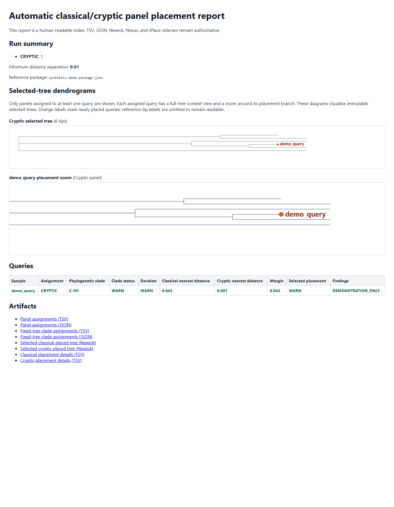

# TreeTip Placer

TreeTip Placer adds query sequences to an immutable, branch-length reference tree without rebuilding its topology. It is designed exclusively for fixed-column FASTA alignments: concatenated MLST allele sequences, concatenated core genes, or core-genome SNP matrices.

## Scope

The current backend performs quality-controlled, distance-based placement on a fixed reference tree. It does not replace a de novo phylogenetic reconstruction or a maximum-likelihood placement engine. The reference alignment, coordinate system, masking policy, and tree must be retained as one versioned reference package.

Tabular MLST allele-profile inputs are intentionally unsupported.

## Input contract

- A branch-length Newick reference tree.
- A fixed-column reference FASTA alignment whose IDs exactly match tree tips.
- A query FASTA alignment mapped to the identical reference columns.

The program will reject unequal alignment widths rather than silently realigning, trimming, padding, or dropping query sites. For SNP-only matrices, retain the original SNP-selection, masking, and ascertainment metadata beside the reference package.

## Automatic classical/cryptic selection

When the origin of an uploaded isolate is unknown, use `place-auto`. It maps the raw query FASTA independently to the immutable classical and cryptic alignments with MAFFT `--add --keeplength`, runs the complete QC/placement workflow for both panels, and then compares the nearest-reference normalized distances.

For routine use, provide one portable paired-reference manifest instead of four individual file paths. Relative paths are resolved beside the manifest and declared SHA-256 checksums are validated before mapping:

```json
{
  "schema_version": 1,
  "minimum_distance_separation": 0.01,
  "classical": {"tree": "classical/tree.nwk", "alignment": "classical/aligned.fasta"},
  "cryptic": {"tree": "cryptic/tree.nwk", "alignment": "cryptic/aligned.fasta"}
}
```

Create the manifest without hand-editing JSON:

```bash
treetip create-reference-package \
  --classical-tree classical/tree.nwk \
  --classical-reference-alignment classical/aligned.fasta \
  --cryptic-tree cryptic/tree.nwk \
  --cryptic-reference-alignment cryptic/aligned.fasta \
  --classical-tip-clades classical_tip_clades.tsv \
  --cryptic-tip-clades cryptic_tip_clades.tsv \
  --min-panel-distance-separation 0.01 \
  --output paired_reference.json
```

Validate a package before sharing or analyzing it:

```bash
treetip validate-reference-package --reference-package paired_reference.json
```

```bash
treetip place-auto \
  --reference-package paired_reference.json \
  --query-fasta uploaded_queries.fasta \
  --mafft /path/to/mafft \
  --output automatic_run \
  --bootstrap 100 \
  --verbose
```

The result is deliberately conservative. `panel_assignment.tsv` contains one `CLASSICAL`, `CRYPTIC`, `AMBIGUOUS`, or `UNRESOLVED` call per query. A call is made only when its nearest-reference distance is better than the other panel by `--min-panel-distance-separation` (default `0.01`). This provisional default was calibrated for the current paired panels and must be recalibrated with known classical, cryptic, and boundary samples whenever either reference package changes. `report.html` is a human-readable index with direct artifact links. For every query, it shows a full clade-context tree and a local placement zoom. The full view expands the query clade and collapses pure non-target clade subtrees as labelled `Clade (n tips)` branches; the zoom displays the query and its visible reference-tip names. Both are display-only and do not modify the fixed tree. `selected_trees/` contains one directly drawable Newick tree per selected panel; `panels/` retains both complete, auditable placement runs.

Synthetic report layout preview (no biological data or real identifiers):



Tip-clade metadata is optional and uses a two-column UTF-8 TSV with the exact headers `reference_tip_id` and `clade`. It can be checksummed into the paired reference package and then loads automatically; command-line TSV paths can explicitly override it for a run. If supplied, `place-auto` writes `clade_assignment.tsv` and JSON. A `PASS` clade call has one label among the annotated descendant reference tips on the selected placement edge. Mixed or unlabelled edge labels use a nearest-labelled-reference fallback only as explicit `WARN`; unavailable labels remain `UNRESOLVED`. An `UNRESOLVED` placement never emits a clade label. These are discrete calls on a fixed reference tree, not a new phylogenetic reconstruction or bootstrap calculation.

For the intended ANI-defined seven-clade classical and cryptic panels, derive a complete reference-tip partition with FastBAPS in a supported environment, map its seven clusters to the independently defined ANI labels, and package the resulting TSV with `--classical-expected-clade-count 7 --cryptic-expected-clade-count 7`. The package validator then rejects any missing reference tip or any partition other than exactly seven labels. A query inherits the label from its fixed-tree placement; `WARN` or `UNRESOLVED` still records a placement/QC limitation rather than silently hiding it.

Validate the discrete clade rule without modifying the backbone with deterministic labelled leave-one-unique-sequence-out controls:

```bash
treetip calibrate-clade-assignment \
  --tree cryptic/tree.nwk \
  --reference-alignment cryptic/aligned.fasta \
  --tip-clades cryptic_tip_clades.tsv \
  --max-controls-per-clade 20 \
  --output cryptic_clade_calibration \
  --preset thorough \
  --verbose
```

For each control, the command removes its tip from the fixed tree and its sequence from the reference alignment, then applies the production placement and discrete clade rule. A clade with only one labelled reference tip is excluded because its label cannot remain after holdout; `clade_calibration_exclusions.tsv` records that fact. `clade_calibration_records.tsv` includes coverage, comparable sites, nearest-reference distance, relative fit weight, objective, and RMSE for every control; `clade_confusion.tsv` and `clade_calibration_summary.json` summarize `CORRECT_PASS`, `CORRECT_WARN`, `INCORRECT_CALL`, and `UNRESOLVED` overall and by truth clade. This is internal validation only; it does not recalculate a topology or phylogenetic support.

Calibrate the paired-panel distance gate with internal leave-one-unique-sequence-out controls:

```bash
treetip calibrate-panel-gate \
  --classical-reference-alignment classical_aligned.fasta \
  --cryptic-reference-alignment cryptic_aligned.fasta \
  --mafft /path/to/mafft \
  --max-controls-per-panel 50 \
  --output gate_calibration \
  --verbose
```

This writes `calibration_records.tsv`, `panel_label_conflicts.tsv`, and `calibration_summary.json`, including a fixed threshold sweep. The conflict table flags high-confidence calls that disagree with the control panel label for provenance review; it never changes source labels or reference membership. The command evaluates the panel-assignment gate only; it does not estimate external generalization, tree-placement accuracy, or phylogenetic support.

## Quick start

```bash
treetip place \
  --tree reference_tree.nwk \
  --reference-alignment reference_aligned.fasta \
  --query-alignment batch_aligned.fasta \
  --output placement_run \
  --preset balanced \
  --threads auto \
  --bootstrap 100 \
  --verbose
```

`placed_tree.nwk` is directly usable in FigTree, iTOL, Dendroscope, ETE, and most Newick-compatible programs. `placements.tsv`, `alternative_edges.tsv`, `query_qc.tsv`, JSON, and event logs provide machine-readable placement and QC detail.

## Quality control

Each query receives `PASS`, `WARN`, `FAIL`, or `UNRESOLVED`. The gate checks alignment coverage, callable-site count, ambiguous nucleotide symbols, nearest-reference distance, and post-placement ambiguity. Thresholds are panel-specific: a cryptic-only reference panel must not reuse distance thresholds calibrated on a mixed cryptic–classical panel.

## Current limitations

- The scorer is categorical fixed-column distance, not maximum likelihood.
- Relative-fit weights are heuristic distance-objective weights, not likelihood weight ratios or posterior probabilities.
- Without requested bootstrap replicates, a diffuse relative-fit weight is reported as `WARN`, not a phylogenetic support value; low requested bootstrap support remains `UNRESOLVED`.
- Local NNI/SPR refinement and recomputed local support are not yet implemented.
- Cross-panel assignment is a distance gate, not a taxonomic classifier or a phylogenetic likelihood-ratio test.

## Development

The test suite uses only synthetic fixtures:

```powershell
python -m unittest discover -s tests -v
```

Do not commit private alignments, genomes, isolates, identifiers, or credentials. Project continuity notes are in [docs/HANDOFF.md](docs/HANDOFF.md).

## License

This private development repository is proprietary and research/development-only. Redistribution or public release requires explicit written permission; see [LICENSE](LICENSE).
